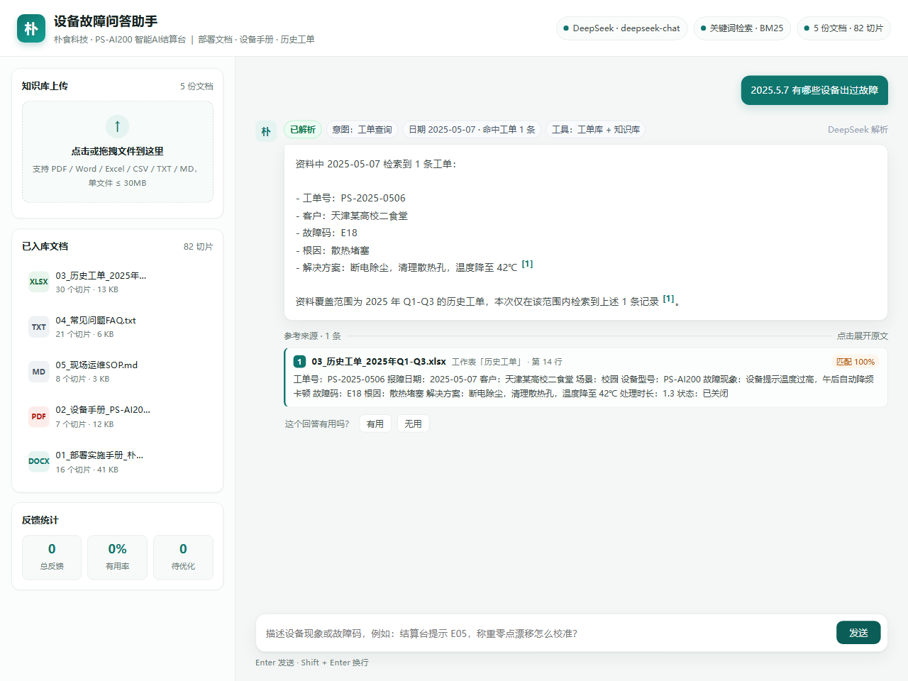

# 设备故障问答助手

> 朴食科技 **PS-AI200 智能 AI 结算台** 的设备故障问答系统，面向银行、校园客户的一线运维与实施工程师。
> 把部署实施手册、设备手册、历史工单、FAQ、现场 SOP 做成知识库，现场描述现象或报故障码，即可给出排查步骤，并标明答案来自哪份文档的哪一页 / 哪一行。



---

## 一、应用场景

### 1. 现场报障，自助排查

食堂高峰结算台卡顿、菜品认错、称重跳数，客户不用等厂商响应，直接在页面描述现象，拿到按顺序排列的排查步骤。

> 问：结算台识别菜品总是出错，怎么排查？
> 答：先擦顶部相机镜头 → 检查照度 300–800lux → 核对模型版本 → 补录新菜品标准图，每步标注来源。

### 2. 按故障码定位

设备只显示一个 `E18`，一线不知道含义。输入故障码即可拿到原因、处置方式与历史同类工单。

> 问：E18 什么原因？
> 答：温度过高 / 散热堵塞，处置为断电除尘、清理散热孔；历史上 E18 共 2 条工单，逐条列出客户、日期与处理结果。

### 3. 按日期 / 工单号复盘

历史工单原来是几十行 Excel，靠肉眼翻。现在可以精确查某天、某个工单号，也能按故障码统计次数。

> 问：2025.5.7 有哪些设备出过故障？
> 答：PS-2025-0506 / 天津某高校二食堂 / E18 散热堵塞 / 断电除尘降至 42℃ / 1.3h / 已关闭，来源为工单表第 14 行。

### 4. 部署与验收支持

实施前确认端口、网络、模型下发步骤、验收项目，避免凭记忆漏项；银行场景会额外提示数据不出内网。

> 问：银行内网部署需要注意什么？
> 答：命中部署手册银行专项与 FAQ，给出白名单、端口、数据落地位置等条目。

### 5. 客户现场的自助入口

部署在客户内网，一线人员先自查，减少重复问题打给技术支持；客户也可以上传自己的验收记录、补充 SOP，形成各自的知识库。

### 6. 知识沉淀与反馈闭环

每条回答都能点“有用 / 无用”，无用可补一句“哪里不准”。反馈落库并统计有用率，反过来指导补文档、调切片；上传工单 Excel 会自动变成结构化记录，不用人工整理。

---

## 二、核心功能

| 分类 | 功能 | 说明 |
| --- | --- | --- |
| 知识库 | 多格式上传 | PDF / Word(.docx) / Excel(.xlsx) / CSV / TXT / MD，多文件拖拽，单文件 ≤ 30MB |
| 知识库 | 文档切割 | 按标题 / 页 / 工作表行 / FAQ 问答切分，默认 520 字、80 字重叠；Excel 每行独立成块，避免多工单合并稀释词频 |
| 知识库 | 工单结构化 | 识别表头自动抽取工单记录，支持按日期、年份、工单号、故障码、客户、现象关键词查询与统计 |
| 知识库 | 文档管理 | 查看每个切片、删除文档（连带切片与工单）、自动重建索引 |
| 问答 | 两段式链路 | 先由 DeepSeek 解析意图与条件，再调用工单库或知识库，最后流式作答；页面显示“意图 · 条件 · 工具” |
| 问答 | 检索 | jieba 分词 + BM25 + 本地字符语义（2/3-gram 哈希向量），RRF 排名融合；领域同义词同时注入两个通道，可选外部 Embedding |
| 问答 | 来源回溯 | 文件名 + 页码 / 工作表行号 / 章节 + 匹配度；正文 `[1]` 点击定位到来源卡片，卡片可展开原文 |
| 问答 | 演示模式 | 未配置 Key 时规则解析照常路由，回答退化为原文摘录，整条链路仍可演示 |
| 运营 | 反馈统计 | 有用 / 无用 + 补充说明入库，侧栏显示反馈总数、有用率、待优化条数 |
| 运营 | 健康检查 | `/api/health`、`/api/config` 查文档数、切片数、模型与检索状态 |

### 典型问答

**日期查询**

```
问：2025.5.7 有哪些设备出过故障
已解析 · 意图：工单查询 · 日期 2025-05-07 · 命中工单 1 条 · 工具：工单库 + 知识库
答：PS-2025-0506 / 天津某高校二食堂 / E18 / 散热堵塞 / 断电除尘降至 42℃ [1]
来源：03_历史工单.xlsx · 工作表「历史工单」· 第 14 行
```

**故障统计（故障码）**

```
问：E18 一共出现过几次
已解析 · 意图：故障统计 · 故障码 E18 · 命中工单 2 条
答：共 2 次，逐条列出日期、客户、现象、根因与处理方式，并说明覆盖范围。
```

**故障统计（口语现象 + 年份）**

```
问：刷卡不识别 2025 年出现过几次
已解析 · 意图：故障统计 · 年份 2025 · 关键词 刷卡/读卡失败 · 命中工单 1 条
答：共 1 次（PS-2025-0215，E08 读卡器无响应），部件词组内 OR 匹配，不会被“识别”等泛词放大计数。
```

---

## 三、技术栈

| 层 | 技术 |
| --- | --- |
| 后端 | Python 3.13 + FastAPI + Uvicorn（SSE 流式） |
| 前端 | 原生 HTML / CSS / JavaScript，无构建步骤 |
| 大模型 | DeepSeek `deepseek-chat`（OpenAI 兼容接口，httpx） |
| 检索 | jieba + 自实现 BM25 + 本地 n-gram 字符语义，RRF 融合；可选 DashScope / OpenAI 兼容 Embedding |
| 存储 | SQLite（documents / chunks / tickets / feedback） |
| 文档解析 | pypdf、python-docx、openpyxl、csv |
| 配置 | 环境变量 → Windows 注册表 → `.env` |

---

## 四、快速开始（Windows）

1. 安装 **Python 3.12 或 3.13**（[python.org](https://www.python.org/downloads/)），安装时勾选 **Add python.exe to PATH**。
2. 克隆或下载本项目：

```bat
git clone https://github.com/GaoXHhhh/equipment-fault-qa-assistant.git
cd equipment-fault-qa-assistant
```

没有 Git 就点 GitHub 页面 **Code → Download ZIP**，解压后进入目录。

3. 启动。在项目根目录的 cmd 里依次执行：

```bat
python -m venv .venv
.venv\Scripts\activate
python -m pip install -r requirements.txt
python -m uvicorn app.main:app --host 127.0.0.1 --port 8000
```

前三行只有第一次需要，之后每次启动只要最后一行。看到 `Uvicorn running on http://127.0.0.1:8000` 后，浏览器打开 **http://127.0.0.1:8000**。

不配 Key 也能用（回答变成知识库原文摘录）。要接 DeepSeek，把 `.env.example` 复制为 `.env`，填入 Key 后重新启动：

```bat
copy .env.example .env
notepad .env
```

在 `.env` 里写 `DEEPSEEK_API_KEY=sk-xxx`。

**macOS / Linux 启动**

```bash
python3 -m venv .venv
source .venv/bin/activate
pip install -r requirements.txt
cp .env.example .env
uvicorn app.main:app --host 127.0.0.1 --port 8000
```

| 脚本 | 用途 |
| --- | --- |
| `run.bat` | 装依赖 + 带 `--reload` 的开发模式 |
| `start_server.bat` | 正式启动，日志写 `data/server.log` |
| `start_hidden.vbs` | 无窗口后台启动 |
| `stop_server.bat` | 结束占用 8000 端口的进程 |

---

## 五、更多

- 技术细节、接口清单、演示动线、Key 配置、上线要点：见 [`docs/技术说明.md`](docs/技术说明.md)
- 已知限制：扫描件 PDF 无 OCR、不支持旧版 `.doc/.xls`、裸写 `5.7` 不识别日期、默认仅本机监听且无鉴权。
- 示例知识库为模拟编写（设备型号、故障码、客户名均为虚构），仅用于流程演示。
